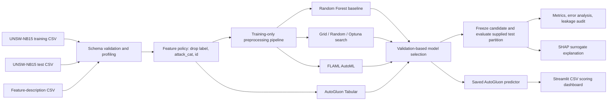

# AutoML-Driven Network Intrusion Detection and Cyberattack Classification

## Detailed Academic Project Report, Architecture, and Presentation Guide

**Dataset:** UNSW-NB15 supplied training and testing partitions  
**Task:** Binary classification, `label` 0 = Normal and 1 = Attack  
**Selected model:** AutoGluon Tabular `WeightedEnsemble_L2`  
**Operating context:** Local academic research prototype; not a production defense system

---

## Abstract

This project implements an end-to-end network intrusion classification workflow using the UNSW-NB15 dataset. It compares a Random Forest baseline with GridSearchCV, RandomizedSearchCV, Optuna TPE, FLAML AutoML, and AutoGluon Tabular. It preserves the supplied train/test separation, fits preprocessing only on training data, chooses a model using training-only validation evidence, and reserves the supplied test partition for final evaluation. AutoGluon WeightedEnsemble_L2 achieved the highest available validation F1 (0.9780) and was selected. On the test partition it achieved attack precision 0.7994, recall 0.9919, F1 0.8853, and ROC-AUC 0.9833. Its high attack recall came with 11,281 false positives among 37,000 normal test records. A deliberately isolated label-copy experiment reached F1 1.0 and demonstrates why target leakage invalidates a score. SHAP was applied to a Random Forest surrogate because the selected AutoGluon ensemble is less convenient to explain directly. A Streamlit application provides local batch scoring and a presentation dashboard. Results are benchmark-specific and do not establish live-network or production suitability.

## Executive summary

- The training file has **175,341 rows × 45 columns** and the held-out test file has **82,332 × 45**.
- `label`, target-derived `attack_cat`, and partition-local sequential `id` were excluded from binary model inputs.
- Training-only preprocessing converts infinities to missing values, imputes numeric and categorical columns, and one-hot encodes categories with unseen-category support.
- All six model families were evaluated using the same supplied test partition after model selection.
- AutoGluon led validation F1 (0.9780); RandomizedSearchCV had the best test F1 among the reported non-ensemble choices (0.9064), while the selected AutoGluon ensemble prioritized recall (0.9919).
- The final model found 44,964/45,332 attacks and generated 11,281 false alarms among 37,000 normal records.
- AutoML searches used 90-second development budgets, not full 900-second runs. The results should be treated as an academic comparison, not a production benchmark.

## 1. Introduction

Network intrusion detection systems analyze events and flows to identify activity that may be malicious. Machine learning can learn patterns from labeled flow statistics, but its usefulness depends on the data collection process, target quality, class coverage, evaluation protocol, and alert threshold. In particular, a high overall score can hide poor recognition of normal traffic or rare attack categories.

This project studies a supervised, binary flow-classification problem using the UNSW-NB15 benchmark. The application is intended to demonstrate a reproducible model development workflow and a local analyst-facing interface. It does not inspect live traffic, scan networks, execute uploaded data, or block connections.

### 1.1 Research question

How do a manually specified Random Forest, conventional hyperparameter searches, and two AutoML systems compare on the supplied UNSW-NB15 split when target leakage is controlled and model selection is based on training-only validation evidence?

### 1.2 Objectives

1. Inspect and validate the supplied traffic partitions and feature-description file.
2. Define a defensible binary input schema and a leakage-safe preprocessing pipeline.
3. Compare a manual baseline, GridSearchCV, RandomizedSearchCV, Optuna TPE, FLAML, and AutoGluon Tabular.
4. Evaluate all selected candidates on the common held-out test partition after search decisions are frozen.
5. Demonstrate target leakage separately and audit split distribution differences.
6. Analyze class imbalance, generalization, and explainability limits.
7. Deliver a local Streamlit application and presentation-ready evidence.

## 2. Dataset description and inspection

### 2.1 Supplied files

The project uses the user-provided files in `dataset/`:

- `UNSW_NB15_training-set.csv`
- `UNSW_NB15_testing-set.csv`
- `NUSW-NB15_features.csv`

The feature-description file is read as a separate schema/reference table. It is not concatenated with traffic records or used as model input. Original dataset files were preserved.

### 2.2 Dimensions and target distributions

| Partition | Rows | Columns | Normal (`label=0`) | Attack (`label=1`) | Attack share |
|---|---:|---:|---:|---:|---:|
| Training | 175,341 | 45 | 56,000 | 119,341 | 68.1% |
| Test | 82,332 | 45 | 37,000 | 45,332 | 55.1% |

The difference in attack prevalence is material. A model evaluated on this split sees a different class mix at test time than it sees during training. Accuracy alone would obscure important consequences of this shift, so attack precision, attack recall, F1, ROC-AUC, PR-AUC, class-level metrics, and the confusion matrix are also reported.

### 2.3 Attack-category representation

Training category counts are: Normal 56,000; Generic 40,000; Exploits 33,393; Fuzzers 18,184; DoS 12,264; Reconnaissance 10,491; Analysis 2,000; Backdoor 1,746; Shellcode 1,133; Worms 130.

Test category counts are: Normal 37,000; Generic 18,871; Exploits 11,132; Fuzzers 6,062; DoS 4,089; Reconnaissance 3,496; Analysis 677; Backdoor 583; Shellcode 378; Worms 44. Worms and several other categories have very low support. Per-category conclusions for rare attacks should therefore be cautious.

### 2.4 Schema quality, missingness, and duplicates

The machine-readable profile records actual column names and types, null counts, infinite-value counts, duplicate-row counts, label distributions, feature-reference fields, numeric train/test KS statistics, and excluded-column rationales. Traffic target values were validated as binary. There are no exact duplicate rows across train/test feature columns in the saved hash-based audit. This check does not prove that no related or correlated flows cross the split.

The most shifted numeric column by KS statistic is `id` (0.5338). It is excluded from the model. Other notable shifts include `sinpkt` (0.1125), `ct_dst_src_ltm` (0.1061), and `ackdat` (0.0982). KS statistics quantify distribution difference; they do not by themselves establish why the shift occurred or whether it causes a specific prediction error.

The supplied flow tables do not include raw endpoint addresses or timestamps, so direct endpoint-group or temporal leakage experiments cannot be performed from these files. `id` is not treated as a substitute for a meaningful time variable.

## 3. Target definition and feature policy

### 3.1 Binary task

The primary task predicts `label`:

- `0`: normal traffic
- `1`: attack traffic

Attack (`1`) is the positive class throughout evaluation.

### 3.2 Excluded columns

| Column | Reason |
|---|---|
| `label` | It is the prediction target and must never be an input. |
| `attack_cat` | It is a second target-derived label; using it would expose attack information. |
| `id` | It is a sequential, partition-local record identifier and shows the strongest numeric split shift; it is not a reusable flow characteristic. |

The resulting binary feature set contains 42 columns. It includes flow duration, protocol/service/state, packet and byte statistics, rates, TTL and TCP statistics, and connection-count features. The optional multiclass task is not implemented as a separate model in this delivered experiment; attack categories are used for profiling and imbalance analysis only.

## 4. Architecture

The diagram separates the training and testing inputs. Preprocessing and search occur within training. The test partition enters only after a candidate has been chosen using validation evidence. The synthetic target-copy experiment is a separate diagnostic and does not feed model selection or deployment.

## 5. Methodology

### 5.1 Reproducibility and environment

Experiments were run with the project interpreter `D:\AUTOML\.venv\Scripts\python.exe`, Python 3.11.9, on Windows 10. The recorded package versions include NumPy 1.26.4, pandas 2.2.3, scikit-learn 1.5.2, SciPy 1.14.1, Optuna 4.1.0, FLAML 2.3.3, AutoGluon Tabular 1.2, SHAP 0.46.0, Streamlit 1.40.2, and pytest 8.3.3. Random seeds are fixed in configuration. The machine reported 12 logical CPUs; AutoGluon observed about 2.81 GB available memory at its run start and used two workers.

### 5.2 Preprocessing

The binary feature selection is performed before fitting. The sklearn `ColumnTransformer` handles numeric and categorical inputs separately:

1. Numeric positive/negative infinity values are converted to missing values.
2. Numeric missing values are imputed with the median learned from training folds/data.
3. Categorical missing values are imputed with the most frequent training value.
4. Categorical values are one-hot encoded, with unseen values safely ignored at inference.
5. The transformations are part of the estimator pipeline, so cross-validation fits transformers inside each training fold.

No preprocessing transformer is fit on the concatenated train/test data. The supplied test partition is not resampled.

### 5.3 Baseline model

The manual baseline is a Random Forest with 160 trees, minimum leaf size 2, `balanced_subsample` class weights, fixed random state, and four parallel jobs. A separate stratified training-only validation split is created from a deterministic 20,000-record sample; 16,000 records fit the validation model and 4,000 records score it. The deployable baseline pipeline is then fit on the complete training partition and evaluated on the common test set. Its validation F1 is 0.9638. Full-fit training F1 is 0.9939.

### 5.4 Grid Search, Random Search, and Optuna

The tuning stage uses a deterministic 50,000-row sample from the training partition and two stratified folds. It uses attack F1 as the search score. The same selected estimator candidates are then evaluated against the held-out test partition.

- **GridSearchCV:** 8 combinations from `n_estimators` {80, 140}, `max_depth` {None, 20}, and `min_samples_leaf` {1, 3}. Search wall time: 67.95 seconds.
- **RandomizedSearchCV:** 8 seeded samples from ranges `n_estimators` 60–180, `max_depth` {None, 12, 20, 30}, and `min_samples_leaf` 1–5. Search wall time: 71.82 seconds.
- **Optuna:** seeded Tree-structured Parzen Estimator (TPE) sampler, eight sequential trials over tree count, depth, and leaf size. Search wall time: 50.20 seconds.

The trial budget is intentionally modest for a resource-limited development run; it is not an exhaustive hyperparameter study.

### 5.5 FLAML

FLAML was run as a binary classification task using training-only train/validation partitions and a nominal 90-second development search budget. It selected LightGBM. Search time was 89.87 seconds; validation F1 was 0.9728. The installed API did not expose detailed trial history in the expected form. The saved record therefore contains the selected estimator/configuration summary, not a fabricated per-trial leaderboard.

### 5.6 AutoGluon Tabular

AutoGluon Tabular 1.2 was given the training partition with the binary target and a nominal 90-second development budget, two CPUs, and medium-quality presets. Its internal validation selected `WeightedEnsemble_L2`, validation F1 0.9780. Observed total training time was 92.66 seconds including overhead. Optional CatBoost and FastAI model families were skipped because their add-on packages were not installed; other available models and the weighted ensemble trained. The predictor was saved, reloaded, and tested for prediction capability.

### 5.7 Selection protocol

The selected candidate maximizes available training-only validation F1 among valid candidates. The supplied test set is not used to choose the winner. The final selected model is AutoGluon because its validation F1 (0.9780) exceeded FLAML (0.9728), the baseline (0.9638), and the tuned Random Forest candidates (approximately 0.962–0.963). This predeclared rule leads to an important finding: the selected model does not have the best test F1. That result is reported rather than changing the rule after seeing test performance.

## 6. Evaluation metrics

For positive class Attack:

- **Accuracy:** fraction of all records classified correctly.
- **Precision:** among predicted attacks, fraction that are attacks; lower precision means more false alarms.
- **Recall:** among actual attacks, fraction detected; lower recall means more missed attacks.
- **F1:** harmonic mean of precision and recall, emphasizing their balance.
- **ROC-AUC:** ranking discrimination across thresholds.
- **PR-AUC / average precision:** precision-recall ranking summary, useful when class proportions are uneven.
- **Confusion matrix:** true/false normal and attack counts at the chosen threshold.
- **Runtime:** measured search/training/prediction times where available; comparisons are qualified because frameworks differ in implementation and resource use.

Validation metrics guide model selection. Test metrics estimate final performance on the supplied held-out partition and are not fed back into tuning.

## 7. Experimental results

| Model | Validation F1 | Test accuracy | Attack precision | Attack recall | Attack F1 | ROC-AUC | Search/training time |
|---|---:|---:|---:|---:|---:|---:|---:|
| Random Forest baseline | 0.9638 | 0.8866 | 0.8395 | 0.9817 | 0.9051 | 0.9839 | 89.26 s full training |
| Grid Search | 0.9629 | 0.8710 | 0.8169 | 0.9870 | 0.8939 | 0.9803 | 67.95 s search |
| Random Search | 0.9623 | **0.8886** | **0.8436** | 0.9792 | **0.9064** | 0.9830 | 71.82 s search |
| Optuna TPE | 0.9631 | 0.8699 | 0.8156 | 0.9869 | 0.8931 | 0.9799 | 50.20 s search |
| FLAML LightGBM | 0.9728 | 0.8663 | 0.8161 | 0.9775 | 0.8895 | 0.9803 | 89.87 s search |
| AutoGluon WeightedEnsemble_L2 | **0.9780** | 0.8585 | 0.7994 | **0.9919** | 0.8853 | **0.9833** | 92.66 s observed total |

The RandomizedSearchCV candidate has the highest test F1 (0.9064), and the baseline follows at 0.9051. AutoGluon is selected by validation F1, but its test F1 is 0.8853. Its very high recall and lower precision indicate a more aggressive alert profile at the default decision threshold. It has the highest ROC-AUC among listed rows (0.9833), but ranking quality does not remove threshold-specific false alarms.

### 7.1 Final confusion matrix

Rows are actual classes and columns are predictions.

| Actual \\ Predicted | Normal | Attack |
|---|---:|---:|
| Normal | 25,719 | 11,281 |
| Attack | 368 | 44,964 |

The selected model correctly identifies 44,964 attacks and misses 368. It flags 11,281 of 37,000 normal records as attacks. Therefore, a presentation should emphasize both the high attack recall and the high review burden implied by false positives. A deployment decision would require threshold calibration against an explicit operational cost model, which was not performed here.

### 7.2 Generalization gap

The full-training baseline F1 is 0.9939, whereas its held-out test F1 is 0.9051. This gap may reflect overfitting, differences in class prevalence and feature distributions, and the fact that the supplied partitions represent distinct subsets. The model is not retrained on test data. Good performance on this benchmark does not prove transfer to live traffic or other datasets.

## 8. Data leakage experiment

The valid diagnostic uses a stratified training-only split and valid features; its F1 is 0.9609. A second, intentionally invalid diagnostic adds an exact target copy under `__intentional_leak_label`; it reaches F1 1.0. The perfect score is caused by direct answer exposure. It is kept in `leakage_results.csv`, separate from all valid model comparisons and saved deployment artifacts. It is not evidence of genuine intrusion-detection capability.

The natural leakage audit excludes `label` and `attack_cat` from the binary model and treats `id` cautiously. The test set has no exact duplicate input rows with training according to the saved hash audit, but correlated/related flows may still exist and cannot be completely assessed from available identifiers.

## 9. Imbalance, class representation, and collection bias

The train/test attack prevalence changes from 68.1% to 55.1%. The rarest attack family, Worms, has 130 training and 44 test records. Backdoor and Shellcode are also rare. With limited support, category-specific recall estimates can have high uncertainty. The binary aggregate metrics can conceal rare-category failures.

No demographic fairness analysis is claimed because the dataset does not provide meaningful demographic groups. The relevant concerns are attack-class imbalance, benchmark collection bias, changing class mix, and possible under-representation of rare attack families. Class weighting is used in the Random Forest baseline; no held-out data is resampled.

## 10. Explainability

The final AutoGluon model is a stacked/weighted ensemble. The SHAP deliverables were generated using a Random Forest surrogate for computational and compatibility reasons. The surrogate is not the selected deployed predictor. The global summary, mean absolute importance, and one local explanation describe Random Forest behavior only.

The local SHAP values are for class 1 (Attack): positive values push the surrogate output toward Attack and negative values toward Normal. They are additive attribution values for a fitted model, not causal effects. The explanation sample is small (100 records) to fit available resources. The limits should be stated whenever those charts are shown.

## 11. Application and reproducibility

The local Streamlit application loads the selected predictor once, validates uploaded columns, refuses missing required features rather than fabricating values, caps files at 50,000 rows, excludes target fields from inference inputs, shows row predictions and attack probabilities when available, and provides a downloadable scored CSV. Three target-free demo files are present: balanced, attack-heavy, and normal-heavy held-out samples.

The project uses Python 3.11.9 and the project-local `.venv`. Main installed versions are NumPy 1.26.4, pandas 2.2.3, scikit-learn 1.5.2, SciPy 1.14.1, Optuna 4.1.0, FLAML 2.3.3, AutoGluon Tabular 1.2, SHAP 0.46.0, Streamlit 1.40.2, and pytest 8.3.3. Full experiment metadata and dependency lock are saved in the project. Development-mode AutoML budgets were 90 seconds, not 900 seconds.

## 12. Limitations and future work

1. Results are specific to UNSW-NB15 and its supplied split; no external dataset or live network validation was conducted.
2. The test set differs from training in attack prevalence and some numeric feature distributions.
3. Rare attack classes have few examples and may be poorly characterized.
4. The AutoML budgets were short development budgets; longer runs may change results.
5. Equal wall-clock budgets do not ensure identical CPU, memory, or search opportunities.
6. Detailed FLAML trial history was not exposed by the installed API; only its selected configuration summary is recorded.
7. Optional AutoGluon CatBoost/FastAI add-ons were unavailable and skipped.
8. SHAP explains a Random Forest surrogate, not the selected AutoGluon ensemble.
9. No decision-threshold optimization against analyst workload or operational loss was performed.
10. The feature tables lack source/destination address and timestamp fields for direct group/temporal split tests.

Recommended next steps are longer, logged search budgets; independent external datasets; flow/session group-aware and temporal validation where identifiers permit; uncertainty intervals for rare-class metrics; threshold selection based on false-positive costs; and direct explanation support for the deployed ensemble.

## 13. Conclusion

The project implements a complete and auditable benchmark workflow, from dataset profiling through model selection, held-out evaluation, leakage diagnosis, explanation, and local demonstration. AutoGluon achieved the strongest validation F1 and was selected under the stated rule. Its test results show a useful high-recall point but also a large false-positive burden, while the RandomizedSearchCV Random Forest achieved the strongest test F1 in this run. The distinction between validation selection and test comparison is central: test results are reported as evidence, not used to retroactively choose the winner. The model remains an academic prototype requiring broader validation before any operational use.

## References (10)

1. Moustafa, N., & Slay, J. (2015). “UNSW-NB15: A Comprehensive Data Set for Network Intrusion Detection Systems.” *Military Communications and Information Systems Conference (MilCIS)*. DOI: [10.1109/MilCIS.2015.7348942](https://doi.org/10.1109/MilCIS.2015.7348942).
2. UNSW Canberra. *The UNSW-NB15 Dataset*. [Official dataset page](https://research.unsw.edu.au/projects/unsw-nb15-dataset).
3. Moustafa, N., & Slay, J. (2016). “The Evaluation of Network Anomaly Detection Systems: Statistical Analysis of the UNSW-NB15 Data Set and the Comparison with the KDD99 Data Set.” *Information Security Journal: A Global Perspective*, 25(1–3), 18–31. DOI: [10.1080/19393555.2015.112597 ನಾಲ](https://doi.org/10.1080/19393555.2015.1125974).
4. Feurer, M., & Hutter, F. (2019). “Hyperparameter Optimization.” In *Automated Machine Learning: Methods, Systems, Challenges*. Springer. DOI: [10.1007/978-3-030-05318-5_1](https://doi.org/10.1007/978-3-030-05318-5_1).
5. Akiba, T., Sano, S., Yanase, T., Ohta, T., & Koyama, M. (2019). “Optuna: A Next-generation Hyperparameter Optimization Framework.” *Proceedings of KDD 2019*. DOI: [10.1145/3292500.3330701](https://doi.org/10.1145/3292500.3330701).
6. Wang, C., Wu, Q., Weimer, M., & Zhu, E. (2021). “FLAML: A Fast and Lightweight AutoML Library.” *Proceedings of Machine Learning and Systems (MLSys)*. [Paper](https://proceedings.mlsys.org/paper_files/paper/2021/hash/6cbe5f51e7d2e8c9a15a08eac138a90c-Abstract.html); [official docs](https://microsoft.github.io/FLAML/).
7. Erickson, N., Mueller, J., Shirkov, A., et al. (2020). “AutoGluon-Tabular: Robust and Accurate AutoML for Structured Data.” [arXiv:2003.06505](https://arxiv.org/abs/2003.06505); [official docs](https://auto.gluon.ai/).
8. Lundberg, S. M., & Lee, S.-I. (2017). “A Unified Approach to Interpreting Model Predictions.” *Advances in Neural Information Processing Systems (NeurIPS)*. [Paper](https://papers.nips.cc/paper/7062-a-unified-approach-to-interpreting-model-predictions).
9. Breiman, L. (2001). “Random Forests.” *Machine Learning*, 45, 5–32. DOI: [10.1023/A:1010933404324](https://doi.org/10.1023/A:1010933404324).
10. Saito, T., & Rehmsmeier, M. (2015). “The Precision-Recall Plot Is More Informative than the ROC Plot When Evaluating Binary Classifiers on Imbalanced Datasets.” *PLOS ONE*, 10(3), e0118432. DOI: [10.1371/journal.pone.0118432](https://doi.org/10.1371/journal.pone.0118432).

## Appendix A — Files supporting this report

- `results/dataset_profile.json` — schema, quality, target distributions, split statistics.
- `results/unified_comparison.csv` — common comparison table.
- `results/final_model_metrics.json` — selected model test metrics and confusion matrix.
- `results/tuning_results.csv` and `results/*_cv_results.csv` — search results.
- `results/autogluon_leaderboard.csv` and `results/flaml_metrics.json` — AutoML evidence.
- `results/leakage_results.csv` and `results/bias_analysis.json` — leakage and class analysis.
- `results/shap_local_explanation.json` and `results/figures/` — explainability and generated figures.
- `results/model_card.md` — intended use, metrics, and risk summary.
